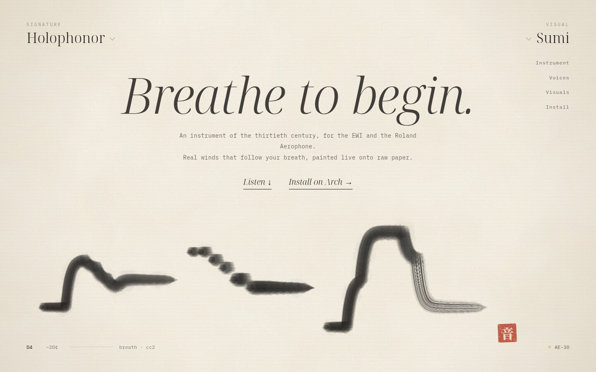
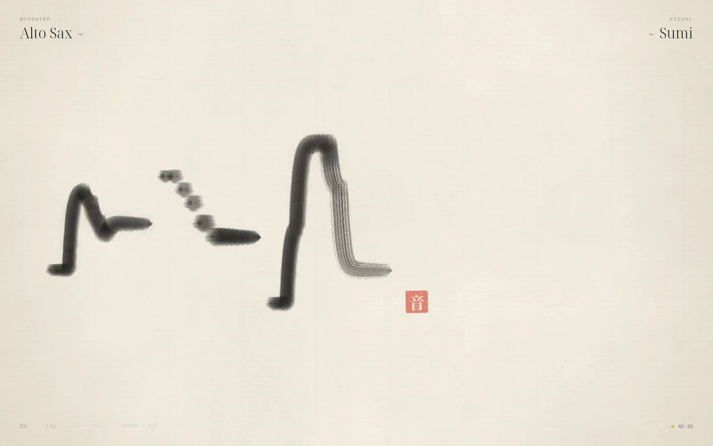
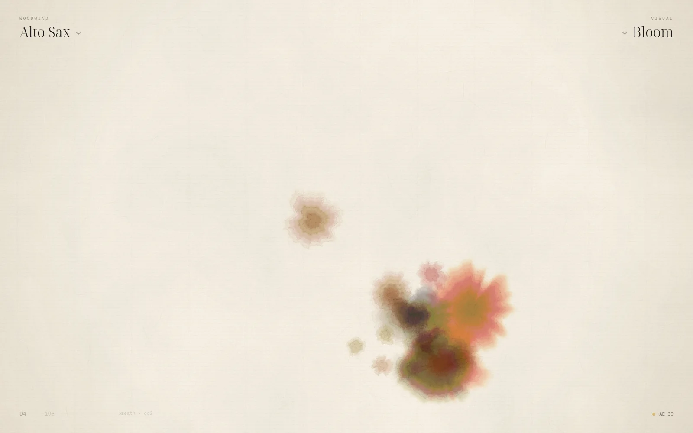
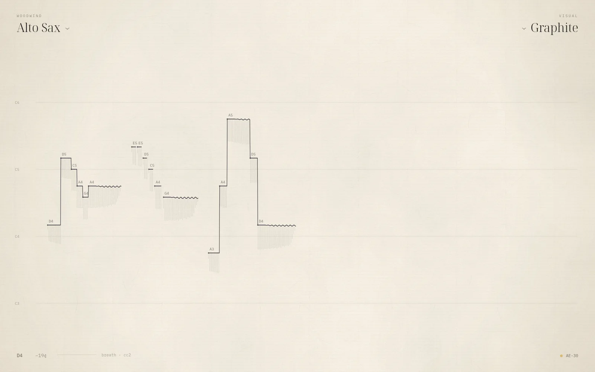
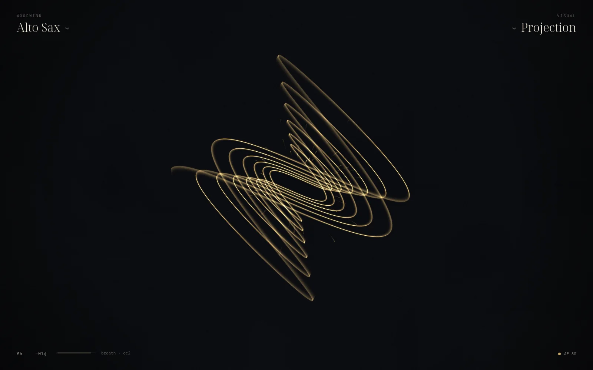

<p align="center">
  
</p>

<h1 align="center"><em>Holophonor</em></h1>

<p align="center">
  <b>Breathe into an EWI or Aerophone, and paint with sound.</b><br>
  <sub>Real winds that follow your breath&nbsp;·&nbsp;four ways to see the music&nbsp;·&nbsp;native on Arch Linux and Omarchy</sub>
</p>

<p align="center">
  <a href="#run-it">Install</a>&nbsp;&nbsp;·&nbsp;&nbsp;<a href="#plug-in-a-wind-controller">Sensors</a>&nbsp;&nbsp;·&nbsp;&nbsp;<a href="#instruments">Voices</a>&nbsp;&nbsp;·&nbsp;&nbsp;<a href="#visuals">Visuals</a>&nbsp;&nbsp;·&nbsp;&nbsp;<a href="docs/">The page</a>
</p>

<br>

A sheet of raw xuan paper fills the window. Plug in an EWI or Aerophone and
it's found straight away. Breathe, and the instrument sounds while a brush
writes the melody across the sheet. The instrument is at the top left and
how the music is drawn is at the top right. That's all the interface there is.

Built for Arch Linux and Omarchy: C++ and Qt Quick, PipeWire for sound, the
ALSA sequencer for MIDI, and the Omarchy theme for its colours.

The project page lives in [`docs/`](docs/). Open `docs/index.html` in a
browser, or serve the folder with any static host.

## Run it

```sh
bin/build                   # qmake6 + make → build/holophonor
build/holophonor --demo     # hear and see a short phrase without an EWI
bin/test                    # the test suite, offscreen
bin/install                 # makepkg -fsi: installs it into the app launcher
```

You need `qt6-base`, `qt6-declarative`, `qt6-wayland`, `libpipewire` and
`alsa-lib`, all of which Omarchy already has. The fonts are Noto Serif
Display, iA Writer Mono and Noto Serif CJK (for the seal). If one is missing,
Qt substitutes another font.

## Plug in a wind controller

Any class-compliant USB MIDI device is connected as soon as the kernel
creates its port. That covers Roland's Aerophones (the AE-30 shows up as
`AE-30`), the Akai EWI USB, EWI4000s and EWI5000, and most keyboards and
interfaces. Wind controllers get the accent dot and are preferred. You don't
need to connect anything by hand.

Breath is read from **CC2, CC11, CC7 or channel aftertouch**, whichever
arrives first, because controllers can be set to send any of them. An AE-30
sends CC2 and a shaped copy on CC11; the first one to arrive wins. If notes
arrive with no breath behind them, the synth falls back to envelopes. That
happens when the controller is unplugged and a keyboard takes over.

| Gesture           | MIDI it sends            | What Holophonor does                                        |
|-------------------|--------------------------|-------------------------------------------------------------|
| Breath            | CC2 / CC11 / CC7 / AT    | Loudness and timbre, continuously, from pp through ff       |
| Tonguing          | Note on (velocity)       | A new attack. Velocity, the breath at the tongue, picks the recorded soft, normal or accented attack |
| Slur              | Note on before note off  | The pitch changes at once. No glide, no new attack          |
| Bite              | Pitch bend               | Vibrato. Pitch, loudness and tone move together             |
| Bend / joystick   | Pitch bend               | ±2 semitones                                                |
| Mod               | CC1                      | Adds vibrato depth                                          |
| Portamento        | CC65 on, CC5 time        | Glides, only when you turn them on                          |

The computer keys get a gentle automatic vibrato. A breath player brings
their own through the bite sensor, so the synth adds none. On an Aerophone
the bite only reaches MIDI if the scene's MIDI settings send it: assign Bite
to pitch bend (a downward bend is fine) or to CC1. The AE-30 these voices
were tested with sent breath and notes but no bite, so check that setting.

## Play without one

When no menu is open, the computer keyboard plays too:

```
 W E   T Y U   O P        black keys
A S D F G H J K L ; '     C D E F G A B C D E F   (A = middle C)
Z / X  octave down / up
```

Keyboard notes are polyphonic and use an envelope, and they still play while
an EWI is connected.

## Visuals

<table>
  <tr>
    <td width="50%"></td>
    <td width="50%"></td>
  </tr>
  <tr>
    <td width="50%"></td>
    <td width="50%"></td>
  </tr>
</table>

| Key | Mode       | What it draws                                                              |
|-----|------------|----------------------------------------------------------------------------|
| 1   | Sumi       | One ink brush: pitch is height, breath is weight, rests leave space, and a vermilion seal is stamped when a phrase settles |
| 2   | Bloom      | A watercolour pool for each note. The circle of fifths picks the pigment from your Omarchy theme, and the melody walks the brush |
| 3   | Graphite   | An engraved score line, with breath as hatching and every note named      |
| 4   | Projection | The Holophonor's light: a damped harmonograph of the interval from the phrase's first note, drawn in your theme's accent |

Press `Ctrl S` to save the painting to `~/Pictures/Holophonor/`. `Space`
starts a fresh sheet. Long performances sink into the paper as faint ghosts,
so they never turn into a smear.

## Instruments

30 voices. Every one responds to breath continuously.

The acoustic winds are **measured from real players**. Each is a profile of a
real instrument, taken from the University of Iowa Musical Instrument
Samples: every note at pp, mf and ff. A profile holds the harmonics, the
breath noise between them, and the first 120 ms of each real tongued attack.
Playing it:

1. A tongued note starts with that recorded attack.
2. The sound then hands over, in phase, to resynthesised harmonics.
3. Breath moves continuously between the recorded pp, mf and ff spectra, so
   blowing harder brightens the tone the way it does on the real instrument.

Pitch is exact equal temperament. Tenor and baritone are built from the alto
recordings, played as instruments a fifth and an octave larger.

- **Signature**: Holophonor, an oboe core with glassy upper partials that beat slowly against each other
- **Woodwind** (measured): Soprano Sax, Alto Sax, Tenor Sax, Baritone Sax, Clarinet, Flute, Oboe, Bassoon
- **Brass** (measured): Trumpet, French Horn, Trombone
- **Strings**: Violin, Cello, String Ensemble
- **Voice**: Choir Aah, Whistle
- **World Winds**: Shakuhachi, Pan Flute, Ocarina
- **Synth**: Analog Lead, Glass Pad, Sub Bass, Aether
- **Plucked**: Harp, Nylon Guitar, Koto (Karplus–Strong)
- **Keys & Mallets**: Electric Piano, Glass Bells, Marimba (two-operator FM)

Search matches names, families, tags and initials, so "reed", "brass" and
"frhn" all work.

## Shortcuts

| Key               | Action                                  |
|-------------------|-----------------------------------------|
| `/` or `Ctrl K`   | Search instruments                      |
| `[` `]`           | Previous / next instrument              |
| `V`               | Choose a visual                         |
| `1` – `4`         | Sumi · Bloom · Graphite · Projection    |
| `Space`           | A fresh sheet                           |
| `Ctrl S`          | Save the painting                       |
| `Ctrl D`          | Play the demo phrase                    |
| `A W S E D … K`   | Play from the keyboard                  |
| `Z` `X`           | Octave down / up                        |
| `Esc`             | Silence everything                      |
| `F11`             | Full screen                             |
| `?`               | Show every shortcut                     |
| `Ctrl Q`          | Quit                                    |

Quit is `Ctrl Q` rather than Omarchy's usual `Q`. Q sits right next to the
playing keys, and a stray keypress shouldn't end a performance.

## Command line

```
holophonor [--instrument <id>] [--visual sumi|bloom|graphite|projection]
           [--demo] [--silent] [--size WxH] [--screenshot <png> --after <ms>]
```

`--silent` runs the synth without sending sound to PipeWire. Combined with
`QT_QPA_PLATFORM=offscreen` and `--screenshot`, it renders the app headless.

## How it's built

```
 EWI ─USB─▶ ALSA sequencer ──▶ MidiInput thread ──┐  lock-free SPSC queues
                                                   ├──▶ Synth (PipeWire RT thread)
 keyboard / demo ─────────────▶ UI thread ─────────┘      │ 128 frames · 48 kHz
                                                          ├──▶ PipeWire ──▶ speakers
                                                          ▼
                                         atomic snapshot (pitch, breath, note)
                                                          │ 60 Hz
                                                          ▼
                              InkPainter (QImage) ──▶ InkCanvas (scene graph texture)
```

- `src/synth.*` holds the voices, the breath and legato logic, and a chorus and
  Freeverb-style reverb. Nothing on the audio thread locks or allocates.
- `src/spectral.*` plays the measured instruments. It handles the recorded
  attack and phase-aligned hand-over, a bank of harmonics interpolated
  between the recorded dynamics, breath noise synced to the reed's pulse,
  and slurs.
- `src/profile.*` is the profile format. `data/profiles/*.prof` hold the
  measurements and are compiled into the binary.
- `tools/profile/` rebuilds them. `build-profiles` downloads the Iowa
  recordings (free for any use, without restrictions), and `profile.cpp`
  measures them: it finds each note, its pitch, harmonics, noise and attack,
  then evens out level across notes.
- `src/instruments.*` is the catalog: a set of numbers per preset for the
  Spectral, Wind, Pluck and FM engines.
- `src/midiinput.*` uses the ALSA sequencer. It subscribes to `System:Announce`
  so hot-plugging works, and its auto-connect policy is kernel clients plus
  anything named EWI.
- `src/audioengine.*` is the PipeWire stream. If PipeWire is unreachable it
  falls back to a silent clock and the window says why.
- `src/inkpainter.*` and `src/paper.*` hold the four visual modes and the
  generated paper.
- `src/*.qml` is the window, the two menus and the shortcut card.
- `docs/` is the project page: static HTML, CSS and one script, with no build
  step. The paper, the brush and the projection are browser ports of
  `paper.cpp` and `inkpainter.cpp`. `?poster` draws every animation finished,
  for stills and reduced motion.

## Tests

`bin/test` runs 128 cases offscreen. It covers:

- Every instrument renders finite, unclipped and audible output.
- Every harmonic instrument is in tune within 12 cents at A4 and A5 (YIN).
- Breath shapes loudness, legato falls back to the held note, and pitch bend
  covers ±2 semitones.
- Slurs reach the new pitch within one block, with no glide. Portamento
  glides only when CC65 turns it on.
- Breath players get no automatic vibrato.
- A note tongued before the breath arrives starts cleanly.
- Blowing harder brightens every measured instrument.
- Every profile covers its range and round-trips.
- Keys play while an EWI is latched, and a silent breath source falls back to
  envelopes.
- A virtual "EWI Test Rig" hot-plugged on the real ALSA sequencer is
  connected, heard and released.
- Instrument search works.
- Painting puts ink where the pitch sits, and a fresh sheet and Projection's
  phosphor both return exactly to their ground.
- The theme is followed.
