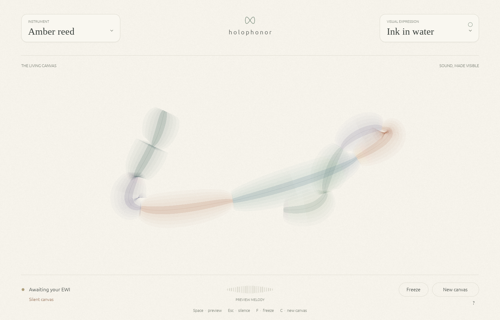

# Holophonor

**Your breath, made visible.**

A native Rust instrument for Arch Linux. Warm paper, four intimate voices, and a canvas that follows your phrasing. Plug in a USB MIDI wind controller, choose a sound at the upper left and a visual expression at the upper right, and play.



## First movement

- **Amber reed, Porcelain flute, Velvet cello, Soft halo:** four original, breath-responsive synthesis voices. These are evocative harmonic instruments, not sampled or validated acoustic reproductions.
- **Ink in water, Watercolor, Constellation:** bounded, local graphics driven by breath, pitch, pitch bend, and phrasing. Freeze a moment or start a fresh canvas without interrupting the audio.
- Automatic MIDI discovery and reconnection, with wind controllers preferred over other inputs. An arriving controller takes over from the preview on its first note.
- Searchable instrument menu, visible connection status, a breath monitor, remembered preferences, and a preview melody for exploring without hardware.
- Configurable MIDI channel and breath CC, 7/14-bit breath, expression, pitch bend range, sustain, monophonic legato with last-note priority, breath calibration, and immediate panic. Active sensing detects stopped controllers when the device sends it.

## Run on Arch Linux / Omarchy

Rust 1.95 or newer is required. Install build and platform dependencies:

```sh
sudo pacman -S --needed base-devel rust pkgconf alsa-lib libglvnd libxkbcommon wayland libx11 libxcursor libxi libxrandr
bin/build
./target/release/holophonor
```

The app supports both Wayland and X11 through OpenGL. Audio uses the default ALSA output, including an ALSA default routed through PipeWire. Set your preferred output in the desktop audio controls before playing. No account, network connection, model download, or sound library is needed at runtime.

```sh
./target/release/holophonor --demo       # Start the preview melody
./target/release/holophonor --silent     # Explore visuals without opening audio
./target/release/holophonor --settings   # Open connections and calibration
```

For an Arch package and launcher entry, run `bin/package` from a committed checkout, then `sudo pacman -U pkgbuild/holophonor-0.1.0-1-x86_64.pkg.tar.zst`. `bin/install` builds and asks pacman to install it. Packaging archives HEAD and verifies that archive's SHA-256. It does not publish a release or change desktop configuration.

## Connect and play

USB MIDI devices appear automatically. “Midi Through” is excluded from automatic selection. Bluetooth/network MIDI, external serial adapters, and non-MIDI controllers are outside this first version.

The default wind profile expects **CC2 breath**, with optional **CC34** for its low seven bits, and a **±2 semitone** pitch bend. EWIs differ: click the connection status below the canvas to change the mapping. “Expression · CC11” uses CC11/43 as breath; “Keyboard” derives breath from note velocity. A separate CC11 expression message scales the default CC2 profile. A profile or port change silences the voice; start a fresh note after changing it.

Set “Resting breath” above the value received at rest and “Full breath” to a comfortable maximum. The meter shows the calibrated value. Channel 0 listens to every channel; set 1–16 if you need isolation. A manual port selection is exact; if ALSA changes its port name after reconnecting, use Automatic discovery or select the new name.

**Esc silences both live MIDI and preview, including the delay tail.** Breath updates cannot undo panic; start a fresh note or press Space to preview. All Sound Off, All Notes Off, device disappearance, and active sensing timeout also recover stuck notes. Held notes are not arbitrarily timed out on controllers that do not send active sensing.

| Key | Action |
| --- | --- |
| Space | Start / stop preview |
| Esc | Silence all sound |
| F | Freeze / resume the art |
| C | New canvas |
| ? | Open the guide |

Instrument and visual controls support Tab focus and Enter/Space activation. Text-entry focus takes precedence over performance shortcuts, except Esc. Close the window to quit; canvas marks are ephemeral and fade after 32 seconds. Freeze preserves them while the app is open. Export and recording are future work.

## Architecture and responsiveness

`src/midi.rs` owns MIDI interpretation; `src/engine.rs` owns discovery and audio devices; `src/synth.rs` owns a fixed harmonic voice; `src/visuals.rs` and `src/app.rs` own painting and interaction. [midir](https://docs.rs/midir/0.11.1/midir/) uses ALSA MIDI, [CPAL](https://docs.rs/cpal/0.18.2/cpal/) negotiates the audio stream, and [eframe/egui](https://docs.rs/eframe/0.36.2/eframe/) renders the native interface. Versions are pinned by Cargo.lock.

The device worker publishes one complete performance snapshot in a 64-bit atomic. Dense CC traffic replaces an older value instead of growing a queue. This intentionally coalesces events between audio buffers; extremely short articulations within a single buffer can be lost. The audio callback never takes a mutex, allocates, reads a file, discovers devices, or performs network work. It owns its preallocated delay and oscillator state, with fixed work per sample. Pitch, level, and timbre changes are smoothed. Harmonics above the synthesis bandwidth are suppressed, and output is softly limited.

Audio prefers a supported 256-frame buffer and retries with the host default if needed. The settings panel reports actual callback frames and their duration, plus stream errors. **Buffer duration is not end-to-end latency.** Stream construction/retry happens outside the audio callback. Audio devices are checked every two seconds; MIDI ports every second. A busy or slow UI does not prevent MIDI from controlling live audio. UI-based preview timing may pause when the window is hidden.

## Verify

```sh
bin/test
# Optional, on a Linux desktop with ALSA devices:
cargo test --test linux_devices -- --ignored --test-threads=1 --nocapture
# Offline WAV and DSP cost, without an output device:
cargo run --release --example render_voice -- artifacts/voices.wav
# Capture the real native window, then exit:
./target/release/holophonor --silent --demo --capture artifacts/canvas.png
```

Device tests create temporary virtual MIDI ports and open a silent audio stream; ordinary tests require neither devices nor a display. See `docs/validation.md` for measured results and what still needs a physical controller and listening session. GitHub Actions runs formatting, Clippy, and device-independent tests.

## Assets and next steps

Paper grain, logo, visual marks, and sounds are generated locally from original code. Embedded Liberation Serif fonts are distributed under SIL OFL 1.1; their license is in `assets/fonts/LICENSE`. Application code is MIT; dependencies and egui's bundled fonts retain their own licenses, collected in `docs/THIRD_PARTY_LICENSES.md`. No sampled instruments or model assets are bundled.

This foundation deliberately leaves realistic sampling/physical modeling, recording/export, accompaniment, model-generated visuals, MIDI 2.0/MPE, and manual audio-device selection for subsequent increments. Physical EWI validation, sustained playing measurements, and listening tests should precede claims about latency, realism, or stage readiness.
